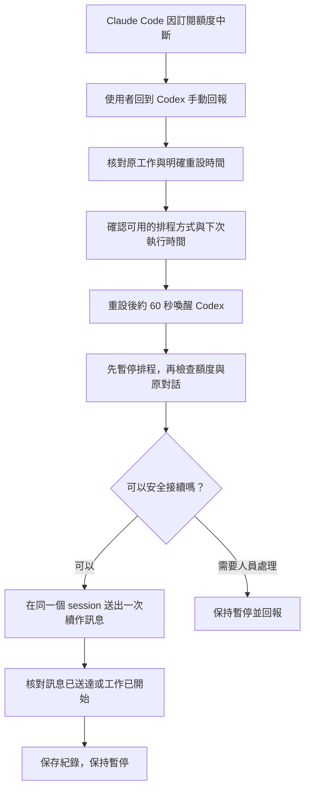

# codex-claude-resume

用 Codex 協助 Claude Code 在訂閱額度恢復後，接續原本未完成的工作。採用**手動回報、到時喚醒一次**的方式，減少等待期間反覆啟動模型的用量。

本 repo 目前提供操作流程、提示詞範本與匿名狀態範例，沒有常駐監控程式、Python 套件或自動安裝腳本。Clone repo 不會建立排程，也不會自動偵測 Claude 的新額度限制。

## 運作方式



沒有明確重設時間，或無法確認排程會在正確時間喚醒時，流程會保持暫停，不啟用每小時輪詢。若續作時再次收到額度限制，只有取得新的明確重設時間，才安排下一次喚醒。

## 目前驗證狀態

2026-11-05 已完成一次受控 CLI 兩階段實測：

- 手動啟動第一階段，保留 session 與未執行的第二階段。
- 原生排程在預定的台北時間 16:15 後約 6.66 秒自行喚醒 Codex，沒有用人工訊息代替觸發。
- 背景回合以 Claude Code CLI `--resume` 接續同一 session，完成第二階段；核對校驗詞、輸出及兩則實際對話內容皆吻合。
- 執行後已恢復原排程的設定及暫停狀態。

**這次驗證的是獨立小任務的定時喚醒與 CLI 非互動模式接續，不是真實額度恢復或原研究工作的續跑。** 測試時用量約 31%，沒有實際額度中斷；桌面 Code UI 與既有互動終端的自動輸入也未通過驗證。其他環境仍須確認可用工具、時間規則及背景權限。詳細方法、輸入隔離修正與結果見 [實測紀錄](docs/testing.md)。

排程建立成功、背景存取成功、真正額度恢復後續跑成功，仍是三件不同的事。

作者的個人 skill、實際排程、本機路徑與工作紀錄未包含在 repo；以下範本可獨立閱讀，不需要作者的 skill。

## 使用前準備

1. 在可存取本機工作的 Codex 桌面聊天中操作，確認有原生排程能力，以及讀取工作狀態、操作原 Claude 視窗或終端的權限。可用工具與權限會依版本、帳號及組織設定而不同。
2. Claude Code 已使用訂閱帳號登入。確認付費額外用量／Usage credits 已關閉；本流程只允許使用原訂閱額度。
3. 保留原工作、工作目錄和 session。若是桌面版，指的是 **Code 分頁**；本流程未針對一般 Chat 或 Cowork 驗證。
4. 到執行時讓電腦保持喚醒、連網，Codex 與 Claude／原終端保持開啟且可操作。睡眠、關機、離線或登入失效都可能阻止續跑。

本流程不會購買額度、切換帳號或供應商，也不會自動放寬權限。

## 第一次設定

取得 repo 後，用 Codex 開啟這個資料夾：

```bash
git clone https://github.com/YI-XIN-Zhan/codex-claude-resume.git
cd codex-claude-resume
```

將以下訊息貼給 Codex：

```text
請閱讀 README.md 與 templates/codex-resume-prompt.md，
依這個流程替我建立手動啟動的 Claude Code 續跑設定。

先確認我要納管的現有工作、原 session 與工作目錄，
並確認付費額外用量已關閉。
用 examples/state.example.json 建立本機狀態紀錄，
將實際路徑與排程 ID 填入提示詞，排程預設暫停。
若已有同一工作的排程，更新它，不建立重複排程。
不要定期喚醒、不要呼叫 Claude 測試額度，也不要送出我的草稿。
設定後回報實際成功與尚未驗證的項目。
```

Codex 應將真實資料保存到本機 `.research/claude-monitor/state.json`。範例中的 `sessions` 為空，必須先登記使用者選定的工作；`null` 與 `false` 是尚未設定／驗證，不能當作成功。填入提示詞的是使用者自己的專案絕對路徑、狀態檔絕對路徑及工具實際回傳的排程 ID。

這次登記的工作才在範圍內，之後新開的對話不會自動加入。每項工作需保存原 session ID、名稱、介面、工作目錄，以及供核對進度與送出紀錄的欄位；不要直接複製另一台電腦的資料。

可以登記多個工作，但本版本**同時只預約一個待續作 session**，以 `scheduled_session_id` 指向它。若另一個工作已有待喚醒預約，保留原預約並回報；除非使用者明確要求改排，不得覆寫。這一輪完成後，再手動安排下一個工作。

## 碰到額度限制：手動啟動

回到負責續跑的同一個 Codex 聊天，告訴它：

```text
Claude 又到額度上限了，幫我安排續跑。
工作名稱：我的研究工作
執行介面：Claude 桌面版的 Code 分頁
畫面顯示的重設時間：2026-11-05 20:00，Asia/Taipei
請核對原工作，安排在重設後約 1 分鐘檢查並接續，執行後恢復暫停。
```

上面的工作名稱與時間只是示例，請換成實際內容；CLI 工作請寫明原終端／session。也可以只說「Claude 又到額度上限了」，再由 Codex 在已授權範圍讀取限制提示。時間含糊或無法讀取時，需要使用者補充，不從碰到限制的時間直接加五小時。

Codex 在安排前應確認：

- 最新回合確實因訂閱額度用盡而停止，且還有已授權工作未完成。
- 重設的完整日期、時間與時區明確；保存時間包含 UTC offset。
- 使用原生工具更新既有排程，並核實下次執行時間是重設後約 60 秒。

原生工具若接受單次規則，就使用單次規則；若只有週期規則，僅在能確認不會提前喚醒時，才採用指定日期／時間並在醒來後立即暫停的方式。**本機已實測指定時間的一次喚醒，但本 repo 仍未提供排程程式；其他環境必須重新確認工具接受的規則與時間。** 工具拒絕、時間不明或無法驗證時，保持暫停並說明原因。

若目前環境無法安排定時喚醒，可以等額度重設後回同一聊天說：「額度已恢復，請現在檢查並接續原工作，不安排排程。」Codex 仍須完成以下核對；這是人工回來觸發，不能算作自動喚醒。

## 到時如何接續原工作

Codex 醒來後先暫停自己的排程，再依 `scheduled_session_id` 核對額度、最新回合與原 session：

- 有未送出草稿、待答問題、權限提示，或使用者正在操作時，保留原狀。
- 已完成、使用者已停止、已取消或封存的工作不重跑；舊的額度錯誤不算新中斷。
- 若 Claude 原生續跑已開始，或原 worker 正在執行，就不再送訊息。
- 桌面工作留在原桌面對話；CLI 工作留在原互動終端。不能把桌面工作另開一個 CLI 副本。

符合條件後，在原對話送出一次：

```text
請從因額度限制中斷的位置，繼續原本已授權且尚未完成的工作。
先核對現有進度，保留已完成成果與研究筆記；子工作只接續未完成部分。
不擴大範圍、不新增付費使用；若已完成或仍需要我回答問題，請停止並說明。
```

送出前記錄待送狀態，送出後核對訊息已出現在原對話或工作已開始，保存時間與事件證據，避免重複送出。僅送出訊息不代表任務已完成。此版本接著保持暫停，不會每小時檢查進度；需要後續審查或再次額度續跑時，由使用者再手動啟動。

若仍因額度被拒，取得新的明確重設時間後才安排下一次；每個工作最多 12 次續作嘗試。登入、權限、未知錯誤或無法定位原對話時保持暫停並通知，不改用其他入口繞過。

## 暫停與取消

在同一個 Codex 聊天說「暫停 Claude 續跑排程」或「取消這次續跑」。Codex 應使用原生工具暫停對應排程、清除本次待喚醒時間並回報結果。暫停此流程不等於停止正在執行的 Claude 工作；要停止 Claude，請明確說明。

## 用量與資料

- 等待期間不啟動 Codex 做固定檢查。手動設定與實際喚醒仍會消耗模型用量，沒有固定節省比例或免費保證。
- 每次只讀狀態與必要的最新事件，避免反覆讀完整對話、掃描所有歷史或用模型請求試探額度。
- `.research/`、環境檔、日誌、暫存工作及輸出已列入 `.gitignore`。只提交匿名範例；真實帳號、session、對話、憑證及個人絕對路徑保留在本機。
- `.gitignore` 不會移除已提交的檔案；公開或推送前仍要檢查實際提交內容。

## Repo 內容

| 檔案 | 用途 |
| --- | --- |
| [README.md](README.md) | 手動啟動、等待重設、接續與停止流程 |
| [templates/codex-resume-prompt.md](templates/codex-resume-prompt.md) | 設定時交給 Codex 的可調整提示詞 |
| [examples/state.example.json](examples/state.example.json) | 不含個人資料的本機狀態起點 |
| [docs/testing.md](docs/testing.md) | 受控 CLI 端到端實測方法、結果及未驗證範圍 |
| [.gitignore](.gitignore) | Python 與本機工作資料的排除規則 |
| [LICENSE](LICENSE) | MIT License |

## 官方參考資料

- [OpenAI：Scheduled tasks](https://learn.chatgpt.com/docs/automations)：同一聊天的排程、原生管理介面與本機執行條件。
- [Claude Code：Usage-limit errors](https://code.claude.com/docs/en/errors#youve-hit-your-session-limit)：訂閱限制、重設時間與桌面 Code 限制卡片。
- [Claude Code：Wait for a usage limit to reset](https://code.claude.com/docs/en/interactive-mode#wait-for-a-usage-limit-to-reset)：原生互動 CLI 的等待與接續條件。若已可用，先避免與 Codex 重複續作。
- [Claude Code：Continue conversations](https://code.claude.com/docs/en/headless#continue-conversations)：CLI 以特定 session 接續的能力；本 repo 未提供非互動 runner。

## License

[MIT](LICENSE)。本專案為獨立的使用流程整理，非 OpenAI 或 Anthropic 官方產品。
